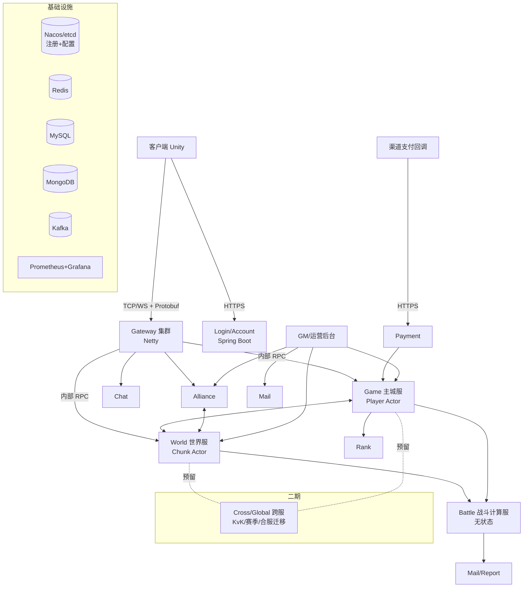
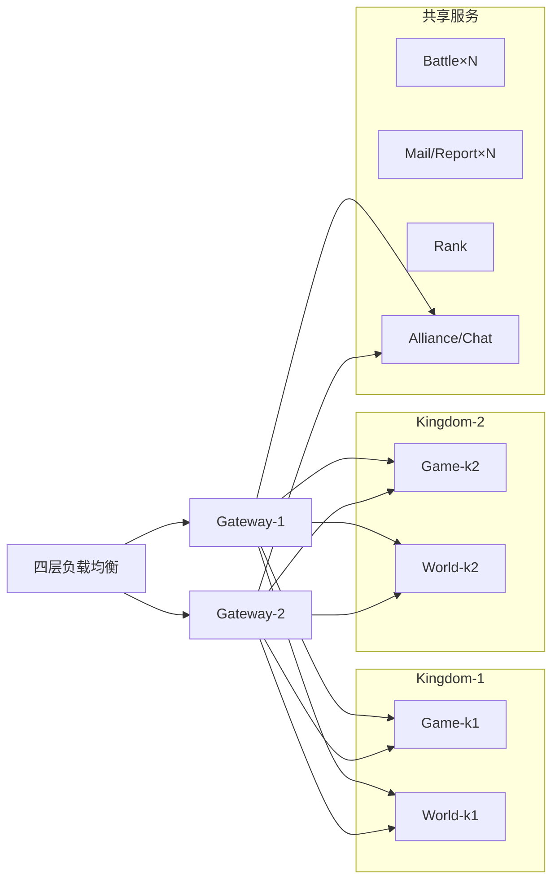

# Java SLG 服务端基础设计文档

> 适用：类《万国觉醒》（Rise of Kingdoms）大地图策略游戏服务端
> 版本：v0.2（基础设计稿，运行时调整为 Java 17）　日期：2026-11-03　状态：待评审
> 范围：只描述架构与关键机制，不含代码；细节设计在各模块详细设计文档中展开。

---

## 1. 概述与设计目标

### 1.1 游戏形态
- 每个 **王国（Kingdom / 服）** 拥有一张共享大地图（约 1200×1200 格），玩家在地图上拥有主城，采集资源、攻打野怪与玩家、集结、建设联盟领地、争夺圣地/关卡。
- 主城内有建筑、科技、训练、治疗等大量 **长时定时行为**（数分钟到数天）。
- 后期有跨服玩法：KvK（王国对战）、赛季服、合服迁移。

### 1.2 设计目标
| 目标 | 说明 |
| --- | --- |
| 一致性 | 单个玩家/单个地图区块状态由唯一线程修改，避免锁竞争与数据错乱 |
| 低延迟 | 常规请求服务端处理 P99 < 50ms；地图视野推送 < 200ms |
| 可恢复 | 进程崩溃丢失数据 ≤ 数秒非付费数据；付费/道具零丢失；重启后定时事件正确补算 |
| 可扩展 | 王国数量水平扩展；单王国内地图可按区块组拆分到多进程（预留） |
| 可运维 | 配置热加载、逻辑热修、全链路监控、灰度发布 |
| 可演进 | 跨服、合服、赛季服首期不做但接口与数据模型预留 |

### 1.3 非目标（首期）
- 不做跨王国实时战斗同步（KvK 二期）。
- 不做多地域多活部署，仅单地域多可用区。

---

## 2. 设计假设（请用户确认/修改）

以下为默认值，**所有容量规划、拆分粒度都基于此**，修改后需重新评估第 13 节部署规模。

| 编号 | 假设项 | 默认值 | 影响 |
| --- | --- | --- | --- |
| A1 | 单王国注册玩家 | 约 50,000 | 内存常驻规模、落库压力 |
| A2 | 单王国同时在线峰值 | 约 5,000 | Gateway 连接数、视野推送量 |
| A3 | 单王国活跃行军峰值 | 约 20,000 支部队 | World 服 Tick 与拦截计算量 |
| A4 | 地图尺寸 | 1200×1200 格，Chunk 32×32 格（约 1400 个 Chunk） | 分区粒度 |
| A5 | 首期王国数量 | 1~10 个，可滚服新增 | 部署规模 |
| A6 | 跨服（KvK/赛季/合服） | **二期实现，首期架构预留** | ID 规范、数据隔离、Cross 服接口 |
| A7 | 客户端 | Unity，TCP 长连接 + Protobuf（WebSocket 作为备选，用于 Web/小游戏） | Gateway 协议栈 |
| A8 | 部署环境 | 单地域 K8s（或物理机 + 容器），多可用区 | 部署拓扑 |
| A9 | 付费渠道 | 国内/海外主流渠道 SDK，服务端回调验单 | Payment 服 |
| A10 | 战斗模型 | 服务端权威、确定性回合制数值战斗（非实时操作） | Battle 服无状态、可回放 |
| A11 | 开发语言/运行时 | Java 17 LTS（无虚拟线程），默认 G1，低停顿需求可试 ZGC（17 中为非分代版） | 线程模型、GC 调优、库版本选型 |

### 2.1 技术栈与版本（均已确认支持 Java 17）

| 类别 | 选型 | 建议版本 | Java 17 兼容性 |
| --- | --- | --- | --- |
| 运行时 | OpenJDK（Temurin/Dragonwell 等） | 17 LTS | — |
| 网络 | Netty | 4.1.x（稳定线）或 4.2.x | 基线 Java 8，支持 17 |
| 序列化 | Protobuf（protobuf-java） | 3.25.x / 4.x | 基线 Java 8 |
| Web/无状态服 | Spring Boot | **3.x**（如 3.4/3.5） | 3.x 要求 Java 17+，17 即最低基线 |
| 服务间 RPC | gRPC-Java | 1.6x+ | 基线 Java 8 |
| Actor（备选） | Apache Pekko | 1.x | 支持 Java 8/11/17/21 |
| 注册/配置 | Nacos Client 2.x 或 jetcd | 2.x / 0.7+ | 基线 Java 8/11 |
| Redis 客户端 | Lettuce（异步 API）/ Redisson | 6.x / 3.x | 基线 Java 8 |
| MySQL | MySQL Connector/J + HikariCP | 8.x/9.x + 5.x | Hikari 5 需 Java 11+ |
| MongoDB | MongoDB Java Driver（Reactive Streams 或同步） | 4.x/5.x | 基线 Java 8 |
| 消息队列 | Kafka Clients | 3.x | 需 Java 11+ |
| 脚本热修 | Groovy | 4.x | 基线 Java 8 |
| 监控 | Micrometer + Prometheus + Grafana | 1.x | 基线 Java 8 |

**Java 17 语言特性约束**（编码规范需明确）：
- 可用：`record`、`sealed` 类、`instanceof` 模式匹配、switch 表达式、文本块。
- 不可用（Java 21 才正式提供）：虚拟线程、`switch` 模式匹配、record 解构模式、Sequenced Collections（`getFirst/getLast/reversed`）、分代 ZGC；结构化并发、ScopedValue 在 21 也仍是预览，一律不用。编译参数统一 `--release 17`，CI 用 JDK 17 构建，防止误用新 API。

---

## 3. 整体架构

### 3.1 架构总览



### 3.2 分层说明
1. **接入层**：Gateway（长连接）、Login（HTTP 短连接）、Payment 回调入口。
2. **有状态逻辑层**：Game、World、Alliance、Chat —— 状态常驻内存、单线程 Actor 修改。
3. **无状态计算/服务层**：Battle、Mail/Report、Rank 查询、GM API —— 可任意水平扩容。
4. **全局层**：Cross/Global（二期）、账号中心、全局 ID、配置中心。
5. **数据与基础设施层**：MySQL、MongoDB、Redis、Kafka、注册中心、监控。

### 3.3 典型请求链路（升级建筑）
1. 客户端 → Gateway：`BuildingUpgradeReq`（携带 seq）。
2. Gateway 根据会话中的 `playerId` 查路由表 → 投递到对应 Game 节点的 Player Actor 邮箱。
3. Player Actor 单线程校验资源/队列 → 扣资源 → 注册定时事件（完成时间）→ 标脏 → 回包。
4. 到点后定时引擎投递 `BuildingFinishEvent` 给该 Player Actor，玩家在线则推送通知。

---

## 4. 各服务职责与边界

| 服务 | 状态 | 职责 | 不负责 |
| --- | --- | --- | --- |
| **Gateway** | 连接态 | Netty 长连接、握手鉴权（校验 Login 签发的 Token）、心跳、加解密/压缩、限流（连接级+协议级令牌桶）、按消息号路由到后端、广播下行合并、断线重连会话保持 | 任何业务逻辑 |
| **Login/Account** | 无状态 | 渠道登录验签、账号绑定、角色列表、选服、服务器列表/维护公告、签发短期 Token（JWT/HMAC）、封号 | 游戏内数据 |
| **Game 主城服** | 有状态 | 每玩家一个 Player Actor：建筑、科技、训练、治疗、背包、任务、VIP、英雄（统帅）、主城 Buff、离线结算 | 地图实体位置、行军过程 |
| **World 世界服** | 有状态 | 每王国一张地图，按 Chunk 分区单线程；地图实体（主城、资源点、野怪、联盟建筑、圣地）、行军、视野订阅推送、遭遇与拦截、驻防/集结 | 战斗数值计算 |
| **Battle** | 无状态 | 确定性战斗计算：输入双方部队/统帅/Buff 快照与随机种子，输出结果与战报（可客户端回放） | 任何持久化 |
| **Alliance** | 有状态 | 联盟成员、职位、科技、帮助、领土、联盟商店、集结发起协调 | 地图实体存储（交给 World） |
| **Chat** | 有状态（轻） | 世界/联盟/私聊/系统频道，敏感词过滤，消息缓存近 N 条，离线拉取 | 邮件 |
| **Mail/Report** | 无状态 | 邮件（系统/个人/联盟）、附件领取（调用 Game 发奖）、战报存储与查询 | 发奖逻辑本身 |
| **Rank** | 半状态 | 战力/击杀/联盟/活动排行，Redis ZSet，定时快照 | 奖励发放（活动模块调用 Mail） |
| **Cross/Global**（二期） | 有状态 | KvK 匹配与战场王国、赛季服生命周期、合服/迁服数据迁移、全局排行 | — |
| **Payment** | 无状态 | 渠道回调验签、订单状态机、幂等发货（调用 Game）、补单、对账 | 商品价格以外的业务 |
| **GM/运营后台** | 无状态 | 查询/修改玩家、封禁、发邮件、活动配置、公告、热更新操作入口、审计日志 | — |

**边界原则**
- 每份状态只有一个 **Owner 服务**；其他服务只能通过消息请求 Owner 修改。
- 玩家主城的「地图实体」由 World 持有（坐标、城防外观、着火状态），主城内部数据由 Game 持有；二者通过事件同步（如城堡等级变化 → World 更新外观）。
- 资源扣除/发放一律在 Game 的 Player Actor 内完成，World 采集完成后发「资源到账」消息给 Game。

---

## 5. 通信与协议

### 5.1 客户端协议
- **传输**：TCP 长连接（主），WebSocket（备选）。
- **帧格式**：`| length(4B) | msgId(4B) | seq(4B) | flags(1B: 压缩/加密) | body(Protobuf) |`
- **seq**：客户端请求自增序号，回包回带；Gateway 用于重复请求去重与断线重连补发。
- **压缩**：body > 512B 时 LZ4/Zstd；地图视野批量推送默认压缩。
- **加密**：握手阶段 ECDH 协商会话密钥，后续 AES-GCM（或 ChaCha20）；也可只对敏感协议加密。
- **消息号段**：按模块分段（如 1xxxx 登录、2xxxx 主城、3xxxx 地图、4xxxx 联盟…），便于 Gateway 路由。
- **推送合并**：同一 Tick 内对同一客户端的多条推送合并为一帧（`BatchPush`）。
- **断线重连**：会话保留 60 秒，期间下行缓存在 Gateway 环形缓冲区，重连带上最后 seq 补发；超时则全量重新拉取。

### 5.2 服务间通信
| 场景 | 方式 | 说明 |
| --- | --- | --- |
| Gateway ↔ 有状态服（高频） | **自定义内部 TCP 协议**（Netty，长连接池，Protobuf） | 低开销，支持单向投递与请求-响应 |
| 有状态服之间（Game↔World↔Alliance） | 同上，Actor 地址寻址 | `ActorRef = (serviceType, nodeId, actorKey)` |
| 调用无状态服（Battle/Mail/Rank/Payment） | **gRPC**（异步 Stub / FutureStub，回调回投 Actor） | 负载均衡、超时、重试 |
| 异步事件/日志/统计 | **Kafka** | 行为日志、BI、战报落库、跨服事件 |
| 运维控制 | HTTP Admin 接口 | 热更、开关、状态查看 |

所有内部请求统一携带：`traceId`、`kingdomId`、`playerId`（如有）、`deadline`。

### 5.3 消息路由
- **注册中心（Nacos/etcd）** 记录：节点 → 服务类型、负载、状态；王国 → World 节点；玩家分片规则 → Game 节点。
- **Game 路由**：`playerId → kingdomId → 该王国的 Game 节点组`，组内按 `hash(playerId) % N` 一致性哈希（或分片表）定位；分片迁移时用「迁出锁定 → 落库 → 迁入加载 → 路由表切换」流程。
- **World 路由**：首期 **一个王国 = 一个 World 进程**（内部 Chunk 多线程）；预留 `chunkId → 节点` 映射，可将一个王国拆分到多个进程。
- **Gateway 本地缓存路由表**，监听注册中心变更推送；路由不一致时后端回 `REDIRECT` 让 Gateway 刷新。

---

## 6. 线程与并发模型

### 6.1 总体原则
> **业务状态单线程修改，IO 优先用异步客户端（Netty EventLoop / CompletableFuture），不可避免的阻塞 IO 交给有界专用线程池，跨 Actor 只发消息不共享可变状态。**

### 6.2 Actor 模型
- 实现选型：**自研轻量 Actor**（首选，可控、易调试），或 Apache Pekko（Typed）。
- 自研方案要点：
  - 每个 Actor 一个 MPSC 无锁邮箱；
  - 由固定大小的 **业务调度线程池**（平台线程，数量 ≈ CPU 核数）调度，一个 Actor 同一时刻只在一个线程上执行（类似 Erlang/Orleans 的 turn-based）；
  - Actor 内禁止阻塞调用；需要 IO 时发起异步调用，结果以消息形式回投自身邮箱；
  - 每条消息执行设置耗时监控，超过阈值（如 20ms）打告警日志。

| Actor 类型 | 粒度 | 所在服务 |
| --- | --- | --- |
| PlayerActor | 每玩家 1 个（在线 + 近期活跃常驻） | Game |
| ChunkActor | 每 Chunk 1 个（或若干 Chunk 组一个 Region Actor） | World |
| AllianceActor | 每联盟 1 个 | Alliance |
| ChannelActor | 每聊天频道 1 个 | Chat |
| KingdomActor | 每王国 1 个（王国级事件、圣地、王位） | World |

### 6.3 IO 线程模型（Java 17，无虚拟线程）

| 线程组 | 类型 | 规模建议 | 用途 |
| --- | --- | --- | --- |
| Netty Boss/Worker EventLoop | 平台线程 | Worker ≈ CPU 核数 | 客户端连接与内部 TCP 收发、编解码；只做转发，不跑业务 |
| Actor 业务调度池 | 平台线程，固定大小 | ≈ CPU 核数 | 执行 Actor 消息，严禁阻塞 |
| 异步客户端回调 | 复用各客户端自带 EventLoop | — | Lettuce（Redis）、gRPC 异步 Stub、Kafka Producer 回调 |
| DB 落库池 | 有界 `ThreadPoolExecutor` | 与连接池大小一致（如 16~32），有界队列 | MySQL/Mongo 同步驱动写入 |
| 通用阻塞 IO 池 | 有界 `ThreadPoolExecutor` | 按下游并发上限配置 | 外部 HTTP（渠道验单）、文件、其它同步 SDK |
| 定时器线程 | 单线程 | 1~2 | 时间轮推进，只投递消息 |

规则：
- **异步优先**：Redis 用 Lettuce 异步 API，gRPC 用 FutureStub/异步 Stub，Kafka 用异步发送；返回 `CompletableFuture`，在 `whenComplete` 中把结果作为消息 **回投 Actor 邮箱**，禁止在回调线程直接改 Actor 状态。
- **阻塞隔离**：JDBC 等同步驱动只能在专用有界池执行（`CompletableFuture.supplyAsync(task, dbExecutor)`），池满时按策略拒绝/降级并告警，避免无界排队导致内存膨胀。
- 所有异步调用设置超时（`orTimeout`），超时也以消息形式回投 Actor 处理。
- **无状态服务（Login、Payment、Mail、GM、Rank 查询）**：Spring Boot 3.x，默认 Tomcat 线程池（按压测调整 `server.tomcat.threads.max`）；高并发入口（如 Login）可选 WebFlux（Netty）响应式栈。数据库访问用 HikariCP 有界连接池，线程数与连接数匹配。
- 线程池统一封装、命名并暴露 Micrometer 指标（活跃数、队列长度、拒绝数）。

### 6.4 跨 Actor 事务
- 不做分布式锁。跨 Actor 操作采用 **请求-确认 + 补偿**：
  - 例：出征 = Game 扣兵（预占）→ World 创建行军 → 成功确认 / 失败回滚预占。
- 所有跨 Actor 消息带幂等 ID，接收方去重。

---

## 7. 定时事件引擎

### 7.1 需求
建造/科技/训练/治疗完成、行军到达、采集结束、Buff 到期、活动开关、联盟帮助过期等，数量巨大（单王国百万级）且跨度从秒到数周。

### 7.2 结构：分层时间轮
```
Level0: 1s 刻度 × 60 槽   (≤1 分钟)
Level1: 1min × 60 槽     (≤1 小时)
Level2: 1h × 24 槽       (≤1 天)
Level3: 1d × 64 槽       (≤64 天，更远的放溢出列表/延迟加载)
```
- 事件放入对应层；高层槽到期时下沉到低层重新分配，最终在 Level0 触发。
- 每个有状态服进程一个引擎实例（或每 Actor 调度组一个），触发时 **投递消息到目标 Actor 邮箱**，不在时间轮线程执行业务。
- 行军等需要亚秒精度的，由 World 的 Chunk Tick（如 200ms）处理，不进入时间轮。

### 7.3 持久化与重启补算
- 事件结构：`eventId, ownerType, ownerId, eventType, fireAt, payload, version`。
- **事件本身就是业务数据的一部分**：例如建筑队列记录 `finishAt`，事件随玩家数据一起落库；引擎只是内存索引。
- 启动流程：
  1. 加载需要常驻的 Actor 数据时，将其未完成事件注册回时间轮；
  2. 对 `fireAt <= now` 的事件 **按时间顺序立即补触发**（同一 Actor 内保证顺序）；
  3. 未加载（离线冷数据）玩家的事件不进入时间轮，由「离线惰性结算」处理。
- 全局/王国级事件（活动开启、圣地开放）存入 MySQL 独立表，由 KingdomActor 启动时加载。

### 7.4 离线惰性结算
- 冷玩家（离线超过阈值、从内存卸载）不跑任何定时器。
- 当玩家上线、被攻击、被查看、收到邮件附件等任何需要其数据的时刻加载，执行 **`settle(now)`**：
  - 按时间顺序推进：建筑完成 → 产量（资源按分段速率累计，考虑 Buff 生效区间）→ 科技完成 → 训练完成 → 治疗完成；
  - 结算有上限（如仓库容量、离线产出上限）；
  - 结算结果标脏落库。
- 冷玩家仍可能被他人影响的部分（主城在地图上被攻打）由 World 持有快照（城防、战力、可掠夺资源估算）；需要真实扣资源时异步加载该玩家并结算后执行。

---

## 8. 世界地图与行军

### 8.1 地图模型
- 坐标：整数格 `(x, y)`，Chunk = 32×32 格，`chunkId = (x>>5, y>>5)`。
- 地图实体（MapEntity）：主城、资源点、野怪、关卡/圣地、联盟建筑（要塞/旗帜/资源中心）、部队（行军中/驻扎）。
- 静态地形（山脉、河流、关卡阻挡）由配置表生成，进程内只读共享。
- 每个 ChunkActor 管理本 Chunk 的实体与经过本 Chunk 的行军登记表。

### 8.2 视野（AOI）订阅
- 客户端上报 **镜头窗口**（中心坐标 + 缩放等级），Gateway 转发 World。
- World 计算窗口覆盖的 Chunk 集合（按缩放级别决定订阅细节：远景只推城堡/联盟领地等宏观信息，近景推全部实体与行军线）。
- 订阅关系：`ChunkActor.subscribers = Set<sessionId>`；镜头移动时做差集，增量订阅/退订，新订阅 Chunk 下发全量快照。
- Chunk 内实体变化在每个 Tick（如 200ms）聚合为增量，推给所有订阅者；Gateway 按会话合并下行。
- 单玩家订阅 Chunk 上限（如 16 个），防止恶意拉取。

### 8.3 行军
- **路径预计算**：出征时由 World 进行寻路（A* / JPS，基于网格+关卡连通图分层寻路），得到折线路径与每段起止时间；行军速度受 Buff 影响，变速时重算剩余路径时间。
- **区块进出登记**：根据路径计算经过的 Chunk 及进出时间，在这些 ChunkActor 中登记「时间区间内经过」；客户端仅需起点、终点、路径、出发时间即可本地插值显示，服务端不逐帧同步位置。
- **事件驱动拦截/遭遇**：
  - 不对所有部队做全量碰撞检测；
  - 拦截/攻击行军时，目标为「移动中的部队」，攻击方路径以目标的预测位置为终点，到达前每次目标变向则重新计算；
  - 到达事件由 Chunk Tick 检测（按到达时间排序的小顶堆），到达时在目标 Chunk 内处理遭遇（战斗、采集、驻防、侦察）。
- **跨 Chunk 交接**：行军实体的归属 Chunk 随当前位置切换，切换时由前一 ChunkActor 发消息移交给下一个。
- **集结**：Alliance 协调发起与加入，等待时间结束后 World 创建集结部队行军；参与成员部队在 Game 侧预占。

### 8.4 并发细节
- 同 Chunk 内操作天然串行；跨 Chunk 交互（如攻击另一个 Chunk 的城）以「到达目标 Chunk 时在目标 Chunk 内处理」为准，避免两边同时修改。
- 王国级共享对象（圣地、王座）由专属 Actor 持有。

---

## 9. 战斗与战报

### 9.1 战斗服设计
- **无状态、纯函数**：`BattleResult = simulate(BattleInput)`。
- `BattleInput`：双方部队（兵种/数量/等级）、统帅（英雄等级、技能、天赋）、全部 Buff 汇总、地形/城防加成、**随机种子**、配置版本号。
- 回合制计算（例如每秒一回合，最多 N 回合或一方溃退），输出：伤亡（重伤/轻伤/死亡）、技能触发序列、每回合关键数值、胜负。
- **确定性**：禁用浮点不确定行为（统一使用定点数或 `long` 万分比），禁止依赖 HashMap 迭代顺序；客户端使用同一算法 + 同一输入即可回放。
- 战斗代码作为独立 jar（`slg-battle-core`），服务端与客户端回放工具（或 C# 移植）共用逻辑与测试用例。

### 9.2 调用流程
1. World 在 ChunkActor 内确定战斗发生 → 收集双方快照 → 通过 gRPC 调用 Battle 集群（或在 World 进程内嵌调用，视性能而定，接口一致）。
2. 结果返回 ChunkActor 应用：部队存活数、行军状态（返回/驻留/溃退）。
3. 伤兵结算、资源掠夺等消息发往双方 Game 的 PlayerActor。
4. 战报发 Kafka → Mail/Report 服写 MongoDB，并给双方生成战报邮件。

### 9.3 战报
- 存储：MongoDB，`reportId`、参与者、摘要（列表展示用）、详情（回放数据，压缩存储）。
- 保留策略：普通战报 30 天 TTL 索引；收藏战报永久（有数量上限）。
- 战报详情较大时只存 BattleInput + 种子 + 配置版本，回放时重算（需保留历史配置版本）。

---

## 10. 数据存储与持久化策略

### 10.1 存储选型
| 存储 | 用途 |
| --- | --- |
| **MySQL** | 账号、角色、玩家核心数据（分模块表或 Blob）、联盟、地图实体、订单、道具/货币流水、全局事件 |
| **MongoDB** | 战报、邮件、聊天历史（可选）、活动记录等文档型大量数据 |
| **Redis** | Token/会话、在线状态、排行榜 ZSet、分布式限流、玩家简要信息缓存（名字/头像/战力）、全局 ID 号段 |
| **Kafka** | 行为日志、BI 埋点、战报异步落库、跨服事件总线 |

### 10.2 玩家数据持久化
- **常驻内存 + 脏标记**：PlayerActor 数据按模块（建筑、科技、背包、英雄…）划分，每模块独立脏标记与版本号。
- **批量异步落库**：
  - 定期（如 30s）或脏数据达阈值时，Actor 内生成脏模块快照（不可变副本/序列化 bytes）交给落库线程（有界 DB 落库池，见 6.3）；
  - 落库按 `playerId` 哈希到固定队列保证同玩家写入顺序；带版本号，低版本覆盖高版本被拒绝；
  - 失败重试 + 告警，超过上限写本地 WAL 文件兜底。
- **同步落库（强一致）**：付费到账、钻石/高价值道具增减、交易类操作 —— **先写流水（MySQL 事务）成功再修改内存并回包**，保证可审计、可回滚、可补单。
- **下线/卸载**：玩家离线 N 分钟后强制落库并卸载内存（保留简要信息缓存）。
- **停服**：拒绝新请求 → 排空邮箱 → 全量落库 → 校验 → 退出。

### 10.3 数据格式与表设计
- 玩家模块数据以 Protobuf 序列化存 `BLOB`（便于扩展字段、少改表），需要运营查询/统计的关键字段（等级、战力、VIP、最后登录）冗余为独立列。
- 所有表主键/ID 采用 **全局唯一 ID**：`64bit = 时间戳 + 王国号/区域号 + 节点号 + 序列`，为合服/跨服预留（见第 11 节）。
- 分库：按王国分库（`slg_k{kingdomId}`），全局库存放账号、订单、跨服数据。

### 10.4 缓存一致性
- 玩家数据以内存为准，Redis 仅存只读简要信息，Owner 修改后异步刷新。
- 禁止其他服务直接读写玩家 MySQL 数据，只能通过 Game 接口。

---

## 11. 跨服与合服预留（二期实现）

### 11.1 首期必须做到的预留
1. **全局唯一 ID**：玩家、联盟、道具实例、邮件、战报 ID 全局唯一，合服无需重编号。
2. **数据带归属标识**：所有数据记录 `originKingdomId`（出生王国）与 `currentKingdomId`。
3. **玩家数据可整体导出/导入**：PlayerActor 数据序列化成完整快照，支持迁移到其他王国的 Game 节点。
4. **World 与王国解耦**：World 进程通过 `kingdomId` 加载地图，同一套代码可启动「KvK 战场王国」或「赛季地图」。
5. **路由支持临时归属**：路由表允许 `playerId → 临时 kingdomId`（KvK 期间玩家进入战场地图）。
6. **名字唯一性**：玩家名/联盟名采用全局唯一或合服时带后缀改名策略。

### 11.2 二期方案概要
- **KvK**：Cross 服匹配若干王国 → 创建战场 World 实例 → 参与玩家的主城地图实体迁入战场地图，Game 数据仍留在原王国 Game 节点（远程调用），结束后迁回。
- **赛季服**：新建独立 World 地图与赛季数据，玩家原数据只读引用，赛季结束结算奖励回原服。
- **合服**：停服 → 数据导出 → 冲突处理（重名、王国排名、联盟合并规则）→ 导入目标库 → 地图重新安置主城 → 路由切换。
- **迁服**：单玩家快照迁移 + 地图重新落城，流程与合服共用工具。

---

## 12. 安全与反作弊（基础要点）

- 所有数值以服务端为准，客户端只提交意图；
- 协议级限频、异常行为（加速、批量脚本）埋点检测；
- GM 操作全部审计，敏感操作双人确认；
- 支付回调验签 + 订单幂等 + 渠道对账。

详细方案后续单独成文。

---

## 13. 部署拓扑与扩容

### 13.1 单王国默认规模（基于第 2 节假设）
| 服务 | 实例 | 规格建议 | 说明 |
| --- | --- | --- | --- |
| Gateway | 2（多王国共享） | 4C8G | 单实例可承载 2~5 万连接 |
| Login | 2（全局共享） | 2C4G | 无状态 |
| Game | 1~2 / 王国 | 8C16G，堆 8~10G | 5 万玩家，活跃部分常驻内存 |
| World | 1 / 王国 | 8C16G | Chunk 多线程；超载时拆分 |
| Battle | 2+（共享） | 4C8G | 按 CPU 扩容 |
| Alliance / Chat | 各 1 / 每若干王国 | 4C8G | |
| Mail/Report / Rank | 各 2（共享） | 4C8G | 无状态 |
| Payment / GM | 各 2（全局） | 2C4G | |
| MySQL | 主从 1 套 / 每若干王国 | | 按王国分库 |
| MongoDB | 副本集 1 套 | | 战报邮件 |
| Redis | 主从/Cluster 1 套 | | |
| Kafka | 3 节点 | | |

### 13.2 部署拓扑


### 13.3 扩容策略
- **新增王国（滚服）**：部署新的 Game + World 实例（或复用资源池），注册中心登记王国 → 节点映射，Login 服务器列表开放即可。
- **无状态服务**：K8s HPA 按 CPU/QPS 自动扩缩。
- **Game 扩容**：分片表调整 + 玩家在线迁移（迁出 → 落库 → 迁入）。
- **World 扩容（预留）**：按 Chunk 区域切分到多进程，跨进程 Chunk 交互走内部 RPC；首期不实现。
- **有状态服发布**：维护停服或「滚动迁移」；常规版本优先使用热更新避免停服。

---

## 14. 监控运维与热更新

### 14.1 监控
- **指标（Prometheus + Grafana）**：在线人数、连接数、各协议 QPS/耗时、Actor 邮箱积压、消息处理耗时分布、时间轮待触发数、落库队列长度/失败数、各有界线程池（活跃数/队列长度/拒绝数）、JVM（GC 停顿、堆、线程）、行军数量、战斗耗时。
- **日志**：结构化 JSON 日志 → Kafka → ELK/Loki；业务行为日志（资源/道具/货币变更）独立 Topic，用于客服查询与 BI。
- **链路追踪**：traceId 贯穿 Gateway → 后端；可接入 OpenTelemetry。
- **告警**：邮箱积压、单消息超时、落库失败、支付异常、在线骤降、GC 停顿 > 200ms。

### 14.2 热更新
| 类型 | 方式 | 适用 |
| --- | --- | --- |
| **配置表热加载** | 策划表（Excel → 导出 JSON/二进制）推送到配置中心/对象存储，服务监听版本号，构建新配置对象后 **原子替换引用**；校验失败则拒绝 | 数值调整、活动配置 |
| **逻辑热修（脚本）** | 预留 Groovy 脚本扩展点（活动规则、GM 修复脚本），脚本经审核后下发执行 | 活动逻辑、数据修复 |
| **逻辑热修（字节码）** | Java Agent + `Instrumentation.redefineClasses` 替换方法体（不改签名/字段） | 紧急 Bug 修复 |
| **功能开关** | 配置中心开关，按协议号/功能模块关闭 | 紧急止损 |

热更新操作统一从 GM 后台发起，记录审计日志，支持按节点灰度与回滚。

### 14.3 运维工具
- 服务管理控制台：节点状态、王国状态、开关服、维护公告。
- 玩家数据查询/修复工具（只读查看 + 审核后修改）。
- 压测机器人：模拟登录、建造、行军、聊天，用于容量验证。

---

## 15. 项目模块划分（Maven 多模块建议）

```
slg-server/
├── slg-bom                  # 依赖版本统一管理（导入 spring-boot-dependencies 3.x、netty-bom、grpc-bom）
├── slg-common               # 工具类、全局ID、时间、异常码、通用模型
├── slg-protocol             # .proto 定义（客户端协议 + 内部协议），生成代码
├── slg-config               # 配置表加载、校验、热加载框架
├── slg-core/
│   ├── slg-actor            # 自研轻量 Actor：邮箱、调度、ActorRef
│   ├── slg-net              # Netty 封装：编解码、内部 RPC、连接池
│   ├── slg-rpc              # gRPC 封装、服务发现、负载均衡
│   ├── slg-timer            # 分层时间轮 + 事件持久化接口
│   ├── slg-persist          # 脏标记、批量落库、流水、WAL
│   └── slg-hotfix           # Groovy 脚本、Java Agent 热修
├── slg-battle-core          # 确定性战斗算法（无依赖，可复用到回放工具）
├── slg-services/
│   ├── slg-gateway
│   ├── slg-login
│   ├── slg-game
│   ├── slg-world
│   ├── slg-battle           # battle-core 的 gRPC 服务壳
│   ├── slg-alliance
│   ├── slg-chat
│   ├── slg-mail             # 邮件 + 战报
│   ├── slg-rank
│   ├── slg-payment
│   ├── slg-gm
│   └── slg-cross            # 二期，先建空模块与接口
├── slg-tools/
│   ├── slg-config-exporter  # Excel → 配置导出
│   ├── slg-robot            # 压测机器人
│   └── slg-migrate          # 合服/迁服工具（二期）
└── deploy/                  # Dockerfile、K8s/Helm、本地 docker-compose
```

**依赖规则**：`services → core → common/protocol/config`；服务之间不直接依赖代码，只依赖 `slg-protocol` 中的接口定义；`slg-battle-core` 不依赖任何框架。

**构建约定**：父 POM 设置 `maven.compiler.release=17`；`maven-enforcer-plugin` 要求 JDK 17 构建（`requireJavaVersion [17,18)`），保证开发、CI、线上运行时一致；容器基础镜像使用 `eclipse-temurin:17-jre`。

---

## 16. 后续里程碑

| 阶段 | 目标 | 主要内容 | 验收标准 |
| --- | --- | --- | --- |
| **M0 骨架** | 工程与基础框架 | Maven 多模块、Netty 网关、Login、Actor 框架、协议工具链、注册中心、docker-compose 本地环境 | 客户端/机器人可登录并收发心跳 |
| **M1 主城** | 单服可玩主城 | Game 服、建筑/科技/训练、时间轮、离线结算、持久化、配置表热加载 | 机器人完成建造升级，重启后数据与定时正确 |
| **M2 大地图** | 地图与行军 | World 服、Chunk、视野订阅、行军、采集、野怪、Battle 服、战报 | 5000 机器人在线行军，视野推送延迟达标 |
| **M3 社交** | 联盟与通信 | Alliance、集结、联盟领地、Chat、Mail、Rank | 联盟集结攻城完整闭环 |
| **M4 商业化与运营** | 可上线 | Payment、GM 后台、监控告警、热修、压测、安全加固 | 压测达到第 2 节容量目标，故障演练通过 |
| **M5 跨服（二期）** | 跨服玩法 | Cross 服、KvK、赛季、合服/迁服工具 | 两王国 KvK 演练、合服演练数据无损 |

---

## 附录 A：待用户确认事项
1. 第 2 节规模假设（注册/在线/行军量、地图尺寸）。
2. 跨服是否确定放二期。
3. Actor 选型：自研轻量 Actor 还是 Pekko。
4. 内部 RPC：Gateway↔有状态服采用自定义 TCP，其余 gRPC —— 是否接受混合方案。
5. 客户端引擎与是否需要 WebSocket/Web 端。
6. 部署环境（云厂商 / K8s / 物理机）。
